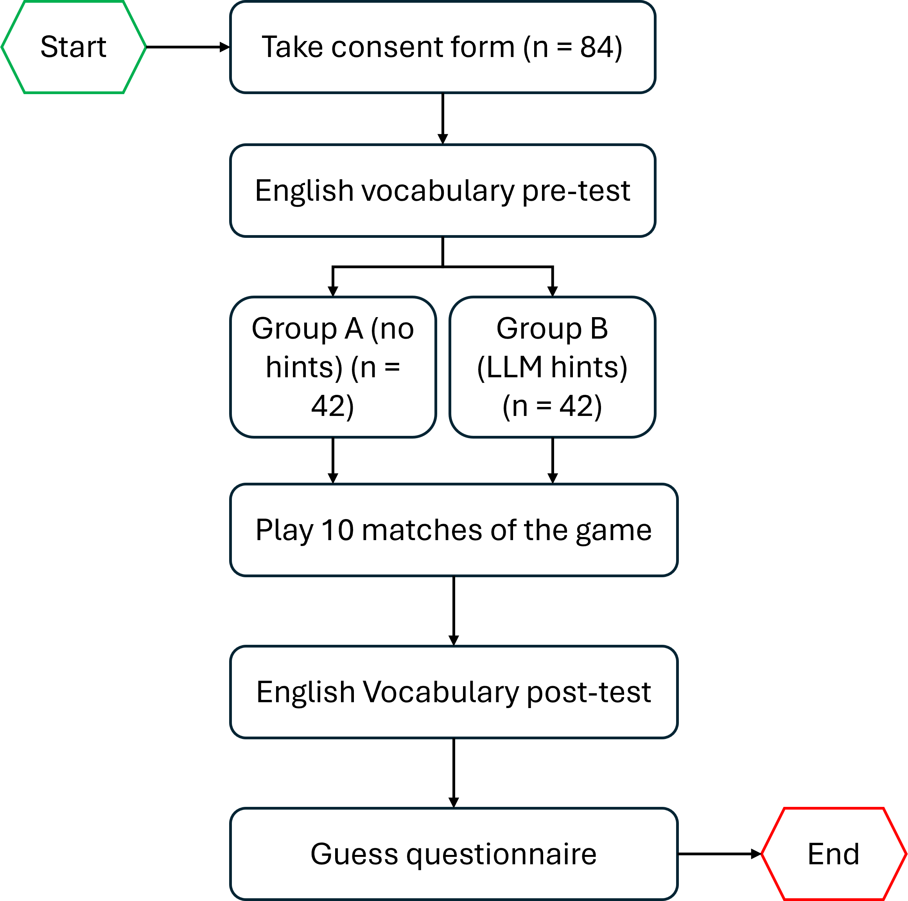

# LLMs in Eduverse: LLM-Integrated English Educational Game in Metaverse

This project was originally introduced in the [2024 IEEE Global Conference on Consumer Electronics (GCCE 2024)](https://www.ieee-gcce.org/2024/index.html) and later extended in a journal publication.

This repository provides the **core API implementation** used in the following publications:

- **[LLMs in Eduverse: LLM-Integrated English Educational Game in Metaverse](https://doi.org/10.1109/GCCE62371.2024.10760474)**  
  *2024 IEEE 13th Global Conference on Consumer Electronics (GCCE)*  

- **[LLMs in EduGame: A Web-Based Interactive English Learning Game](https://doi.org/10.2197/ipsjjip.34.230)**  
  *2026 Journal of Information Processing*  

## Versions

| | This repository | [llms-eduverse-fastapi](https://github.com/pichayakorn/llms-eduverse-fastapi) |
|---|---|---|
| Used in | Eduverse, the multiplayer word-guessing game on Roblox (GCCE 2024) | EduGame, the web version (Journal of Information Processing 2026) |
| Framework | Flask | FastAPI with a Pydantic response model |
| Model | `gpt-3.5-turbo` | `gpt-4o-2024-08-06` |
| Categories | 25 everyday categories (animal, fruit, sport, …) | 10 workplace English categories (business, travel, health, …) |
| Output | 10 words with scores, 5 hints | 10 words with scores, 4 hints, a quiz question with 4 choices |

The journal paper extends and builds upon the system introduced in the GCCE 2024 paper.

## How it works

One request to `GET /generate_words` produces a full round of the game. The API picks a random category and makes a chain of OpenAI function calls, each forced to a specific function so the output is structured:

1. **Words:** 10 words from the category. The first is the target word players must guess.
2. **Scores:** a semantic-similarity score (0 to 1) between the target word and each of the 10 words.
3. **Hints:** a general hint, three fill-in-the-blank hints, and a final hint, each with the target word left out.

Every step checks the model's output and asks again if it's invalid: a word list with duplicates or the wrong length, a score list that isn't 10 long, or a hint that gives away the target word or has more than one blank.

The prompts are in [`prompts/`](prompts/).

### Example response

```json
{
  "hint": [
    { "ID": 1, "question": "…" },
    { "ID": 2, "question": "…" }
  ],
  "words": [
    { "ID": 1, "word": "…", "score": 1.0 },
    { "ID": 2, "word": "…", "score": 0.8 }
  ]
}
```

(Shortened: a real response has 5 hints and 10 words.)

## Protocol of user study conducted.
  


## Setup

### Install Dependencies

1. (optional) Creating conda environment

```
conda create -n metaguesser python=3.11
conda activate metaguesser
```

2. Install required packages

```
pip install -r requirements.txt
```

3. Copy `.env.example` to `.env` and set `OPENAI_API_KEY`.

### Run Flask

```
flask run
```

Then open `http://127.0.0.1:5000/generate_words`.

## Citation
```bibtex
@inproceedings{plupattanakit2024llms1,
  author={Plupattanakit, Kantinan and Suntichaikul, Pratch and Taveekitworachai, Pittawat and Thawonmas, Ruck and White, Jeremy and Sookhanaphibarn, Kingkarn and Choensawat, Worawat},
  booktitle={2024 IEEE 13th Global Conference on Consumer Electronics (GCCE)}, 
  title={LLMs in Eduverse: LLM-Integrated English Educational Game in Metaverse}, 
  year={2024},
  pages={257-258},
  keywords={Metaverse;Large language models;Semantics;Refining;Stochastic processes;Prototypes;Games;Consumer electronics;Large language models;Roblox;Metaverse;Word Guessing Game},
  doi={10.1109/GCCE62371.2024.10760474}}
```
```bibtex
@article{plupattanakit2024llms2,
  title={LLMs in EduGame: A Web-based Interactive English Learning Game},
  author={Kantinan Plupattanakit and Pratch Suntichaikul and Ibrahim Khan and Ruck Thawonmas and Jeremy White and Kingkarn Sookhanaphibarn and Worawat Choensawat},
  journal={Journal of Information Processing},
  volume={34},
  pages={230-238},
  year={2026},
  doi={10.2197/ipsjjip.34.230}
}
```
